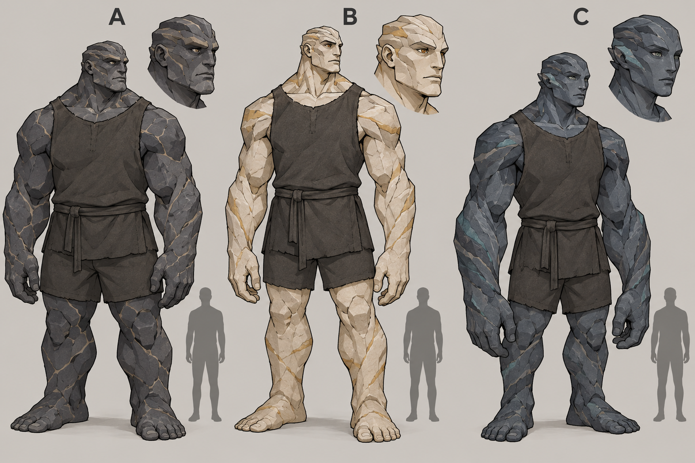
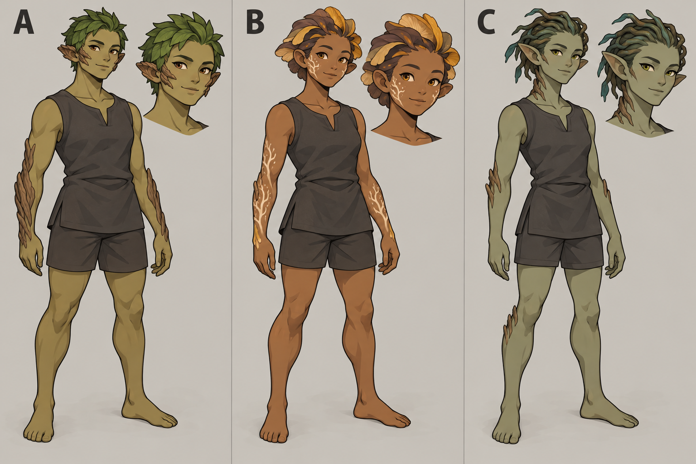
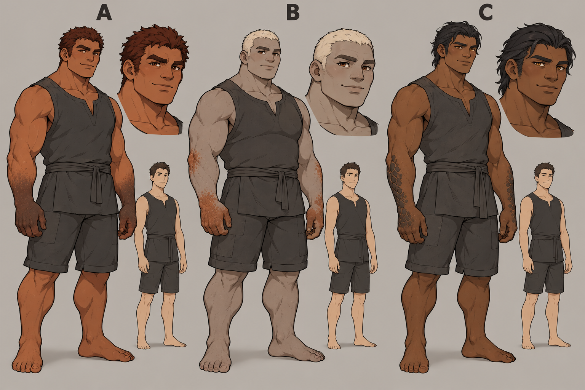
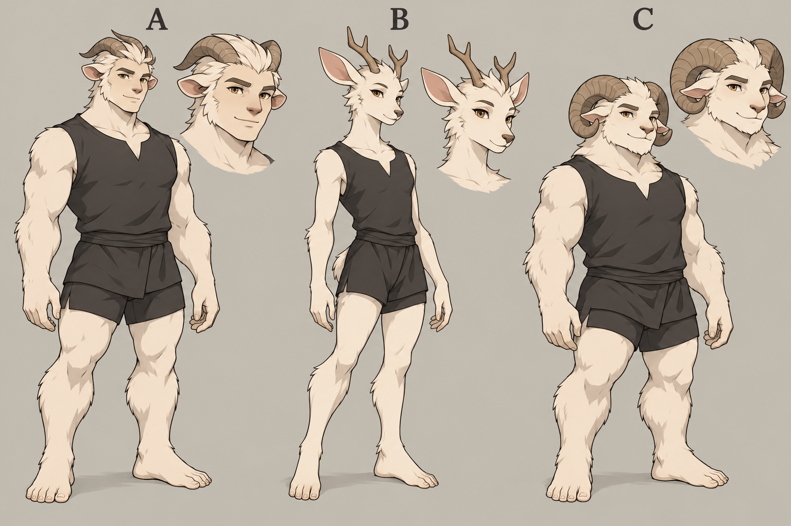
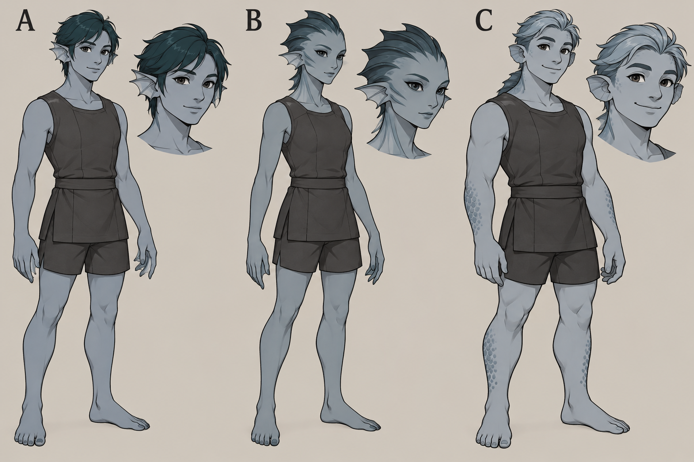
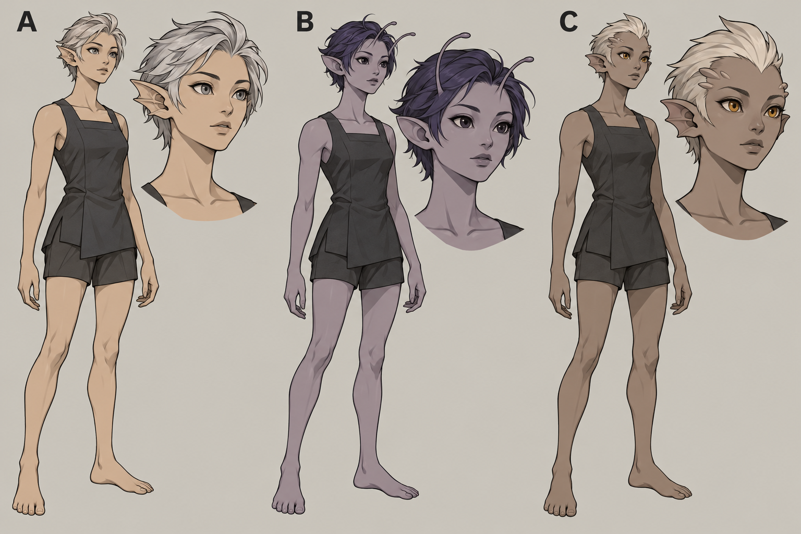

# 六種族・外観候補 v1

2026-10-09。built-in image_genで生成。ユーザー選択待ち。各画像は左A／中B／右C。18案は外観比較用のconceptで、ゲーム用sprite／採用済み種族ではありません。男女差・年齢差は後工程。画像内の比較人物との身長比は設定値を保証せず、特に星墓・炉は実生体bodySizeと描画drawSizeを別に測ります。小さなゲーム表示へ移す際は線と表面模様を減らします。六画像はworkspaceへSHA一致でcopy、元画像を保持しています。

## 星墓の継承者



生成prompt（原文）:

```text
Create one landscape character-design comparison sheet for a RimWorld colony-game mod named Inheritance, specifically the Stargrave mineral-skinned giant species. Three clearly distinct ORIGINAL anatomical design candidates labelled only A, B, C above their columns. Show each candidate in a full-body standing front three-quarter view, plus a small head closeup above its shoulder. Same adult neutral pose and simple charcoal sleeveless work tunic and shorts, hands visible, unobstructed anatomy, no weapons. All are living organic humanoids with stone-like skin, NOT robots or armored humans. A: basalt slate-grey skin, broad squat imposing giant, blunt layered brow and cheek ridges, subtle pale stone seams, human-like nose and ears. B: pale sandstone warm ivory skin, tall wide-shouldered monolithic giant, angular blocklike brow and exposed layered shoulders, amber eyes, minimal ochre mineral seams. C: dark blue-grey layered shale giant, long heavy forearms and compact legs, smooth face with broad cheekplates and small ear ridges, understated muted teal inclusions. All sympathetic intelligent settlement-builders, no gore/horror. Beside each, the SAME small ordinary human grey silhouette for consistent height comparison, giants around 1.5 human height. Graphic style: crisp dark outlines, readable flat color silhouettes with only 2-3 cel shading steps; moderately more detail than vanilla RimWorld pawns but avoid realistic painting, tiny texture noise, ornate engraving, excessive sci-fi armor. Large simple forms legible as top-down sprites later; actual sheet is concept art, no game screenshot. Neutral warm light-grey background, tidy equal-width 3-column layout, plenty of whitespace, restrained palette, precise labels A B C only, no other lettering, no logo or watermark.
```

## 鉄樹の民



生成prompt（原文）:

```text
Create a landscape three-column ORIGINAL species anatomy comparison sheet for the Ironwood people of a RimWorld colony-game mod. Three options A B C, clearly labelled A B C only. Each option shows a full-body standing front three-quarter adult with a small matching face closeup, same simple sleeveless charcoal work tunic and shorts, no weapons or armor; clothing must not hide head, arms, shins. Plant/symbiotic-fungus humanoids at ordinary human height, intelligent warm community farmers and healers, visibly nonhuman anatomy rather than ordinary humans wearing leaves. A: olive skin, smooth bark ridges across exposed forearms and cheekbones, moss-green short leaf-like hair, small wooden ear tips, robust human-like facial expression. B: warm brown skin and rounded understated mushroom/frond hair crest, pale branching symbiotic markings along cheeks and forearms, rounded ears, soft friendly face, restrained mustard and umber accents, no giant mushroom hat. C: muted green-grey skin, branching root-like hair swept back, simple elongated ears and a few small woody ridges along neck and elbows, spare dark teal foliage, slender capable build. Species anatomy is biological and lived-in, not a monster, not a tree trunk, no gore. Same pose, lighting, and proportional adult body in all three, consistent scale. Art direction: crisp clean black outlines, broad flat color areas and 2-3 cel-shading tones, moderately richer than vanilla RimWorld but simple readable forms suitable to simplify into top-down pawn sprites later, no realistic painting, tiny dense leaves, noisy texture, ornate detail. Warm light grey neutral background and equal wide columns with whitespace, no environment, no other text, logo or watermark. This is selectable concept art, not finished sprites.
```

## 炉の氏族



生成prompt（原文）:

```text
One landscape ORIGINAL character anatomy comparison sheet for the Hearth clan species of a RimWorld colony game mod Inheritance. Three distinct options A B C labelled ONLY A B C at top. Each shows full-body neutral standing adult three-quarter front plus one matching face closeup. SAME simple charcoal sleeveless work tunic and knee-length shorts, no helmet, weapons or armor. All physically living humanlike furnace-adapted miners and craftspeople with heavy muscular builds, around 1.2 human height, clearly distinct from mineral-skinned stone giants: their exposed skin is supple biological flesh, NOT stone or metal. A: warm rust-copper skin, sturdy broad neck and chest, short dense dark auburn hair, thick brow, wide jaw and modest heat-resistant darker skin on hands/forearms. B: muted ash-grey flesh, barrel chest, compact powerful build, pale cream close-cropped hair, rounded brow and cheekbone, sparse rust-colored heat-adapted callus patches on elbows and hands. C: deep bronze-brown flesh, tall muscular long-armed frame, swept charcoal hair, broader flatter nose, small darker scale-like callus plates along forearms, subtle golden-brown eyes. No glow, lava cracks, horns, metal skin, robots, fire magic or flames. Same pose, lighting and scale across options; smaller simple ordinary human silhouette alongside each for scale but the main figures are just 20% taller. Friendly self-possessed adult character expression. Crisp clean dark outlines, flat color shapes, 2-3 cel-shading tones, moderate detail slightly more than vanilla RimWorld, no photorealism, texture noise, extreme bodybuilder anatomy or ornate jewelry. Neutral light warm grey background, 3 equal columns and space between figures. This is selectable species concept art, not game-ready sprites; no logo or other text.
```

## 白冠の獣侯



生成prompt（原文）:

```text
Landscape ORIGINAL character species comparison concept sheet for the Whitecrown beast nobles of a RimWorld colony-game mod. Three genuinely different anatomy candidates, labels ONLY A B C above equal columns. Each candidate full-body standing adult front three-quarter view and a small matching face closeup. SAME simple charcoal sleeveless tunic and shorts, no armor, crowns, weapons or jewelry. Species has white or cream short fur and natural horns, capable intelligent citizens and protectors, warm dignified expressions, humanoid hands with 5 fingers. A: fairly human face with broad nose, short white fur on cheeks/arms, short smooth swept-back paired horns, rounded animal ears, powerful broad humanoid body, no muzzle and no hooves. B: elegant cervine humanoid, small modest branching antler-like horns, long mobile deer ears, short gentle deer-like muzzle, cream-white short fur, slim agile frame and humanoid flat feet, not a full animal. C: stockier white-furred caprine humanoid with very short broad muzzle, thick curled ram horns in a readable single arc each, small sideways ears, strong limbs and ordinary humanoid hands and feet. All look biological and plausible as social colonists; no monsters, snarling, demon motifs, huge elaborate antlers, canine wolf skulls. Clear difference between anatomy, not costume changes. Crisp clean dark outlines, broad flat colors with 2-3 cel-shading tones, moderate restrained detail a little richer than vanilla RimWorld, clean simple short fur silhouettes rather than drawing individual hairs, no realistic painted fur, microtextures or ornate fantasy art. Same scale and pose. Light neutral warm grey backdrop, plenty of whitespace. No text except A B C; no logo/watermark; concept art for user selection, not finished game sprites.
```

## 潮環の民



生成prompt（原文）:

```text
Landscape ORIGINAL species design comparison concept sheet for Tide-ring people, amphibious-adapted but fully land-living humanoid citizens of a RimWorld colony-game mod. Three different options labelled ONLY A B C. Each full-body adult standing front three-quarter neutral view, plus a matching small face closeup. Same charcoal sleeveless work tunic and shorts, no weapons, armor or jewelry, ordinary human height and proportions. Main biological identity blue-grey skin and thin subtle membranes; all capable of conventional land settlement life, NOT mermaids, fish bodies, robots, water monsters or tentacles. A: muted blue-grey smooth skin, short dark teal humanlike hair, slightly pointed delicate ears with a small single fin edge, subtle webbing between fingers, dark calm eyes, mostly human face. B: desaturated sea-slate skin, short crest of soft dark fin-shaped strands instead of hair, flattened elegant cheek ridge and two short delicate ear fins, slender fingers and modest neck-fold membranes, distinctly aquatic humanoid face but no fish mouth. C: pale cool grey-blue skin with a restrained darker dorsal neck ridge, swept silver-blue short hair, rounded broad face, small fan-shaped ears, stronger robust limbs, very sparse scale pattern only along outer forearm/shin. Warm expressive approachable face. Keep gill-like neck folds tiny and dignified. No glowing runes, jewellery, luminous body stripes, excessive scales, long waving fins. Crisp dark graphic outlines, broad flat colours, only 2-3 cel-shading steps, restrained medium detail slightly richer than vanilla RimWorld, no realistic painting or texture noise, easy-to-read anatomy intended to become simplified top-down pawn sprites later. Neutral light warm-grey background, neat equal 3 columns with whitespace. No lettering except A B C, no watermark/logo. Concept art for selecting anatomy, not finished sprites.
```

## 空標の民



生成prompt（原文）:

```text
Landscape ORIGINAL character anatomy comparison sheet for Sky-marker people of a RimWorld colony-game mod Inheritance: high-altitude observers and communicators with slender frames and enhanced sensory anatomy. Three distinct adult biological humanoid design options labelled only A B C. Each option full-body standing adult three-quarter front with matching head closeup, same charcoal sleeveless work tunic and shorts, no wings, goggles, jewelry, armor or weapons. Ordinary human height but slimmer shoulders and long agile limbs. A: cool pale tan skin, short swept silver-grey hair, elongated subtly pointed ears with a second small biological cartilage fold, delicate brow and wide alert grey eyes, calm humanlike expressive face. B: muted dusky lavender-grey skin, soft short dark violet hair, two fine short eyebrow antenna-like sensory filaments (not horns), rounded elongated ears, large dark eyes, refined humanoid face; antennae broad enough to read at small game scale, not insect head. C: desaturated warm grey-brown skin, short pale hair with small aerodynamic crest, modest flattened nose bridge and two small sensory ridges at temples, large forward-facing amber eyes, short fin-like ear edges that resemble cartilage rather than aquatic membranes. All are living sympathetic adults, not elves in ornate fantasy costumes, not aliens with giant black heads, not robot antennas, not glowing psychic mystics. Distinct clear head silhouettes across the three. Crisp black outlines, broad clean flat colours and 2-3 cel-shading tones, restrained medium detail slightly more than vanilla RimWorld, no intricate surface texture, realism, painting or excessive anime ornament. Neutral light warm grey backdrop, generous whitespace and tidy equal 3-column design. Letter labels A B C only, no other lettering/logos/watermarks. Selectable concept art, not finished gameplay sprites.
```


